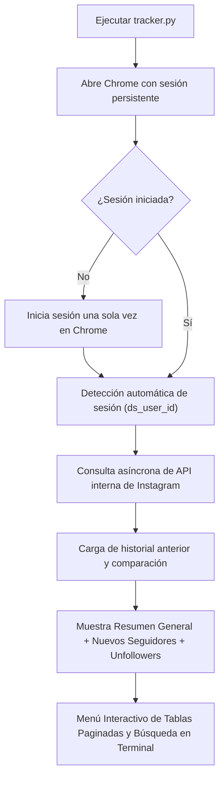

# 📷 Instagram Unfollowers & Followers Tracker Pro (CLI Edition)

> Herramienta inteligente y segura en Python para rastrear tus seguidores y seguidos en Instagram Web desde la terminal, comparar cambios históricos entre fechas (nuevos seguidores y unfollowers) y ver resultados interactivos **sin dejar archivos TXT innecesarios**.

[](https://www.python.org/)
[](https://www.selenium.dev/)
[](https://www.microsoft.com/)
[](LICENSE)

---

## 🌟 Características Principales

- 🚫 **Detección de No Seguidores:** Identifica al instante quiénes de las personas que sigues **no te siguen de vuelta**.
- 👥 **Rastreo Completo de Seguidos y Seguidores:** Accede a la lista completa de a quién sigues y quién te sigue.
- 🤝 **Seguidores Mutuos:** Filtra aquellos contactos con los que te sigues mutuamente.
- 📈 **Comparador Histórico Inteligente:**
  - Guarda capturas automáticas estructuradas en formato JSON interno (`data/history.json`).
  - Al ejecutarlo otro día, compara el estado actual con el anterior y te dice:
    - 🆕 **Nuevos seguidores (+)** desde el último análisis.
    - 📉 **Quiénes te han dejado de seguir (-)** desde el último análisis.
    - ⚠️ **Nuevas cuentas añadidas a la lista de "no te siguen"**.
    - ✨ **Cuentas recuperadas** (que ahora sí te siguen).
- 💻 **100% en Terminal (Sin Archivos TXT):** No ensucia tu carpeta con archivos `.txt`. Toda la información se presenta de forma estructurada en la consola con tablas paginadas, buscador por nombre de usuario o nombre completo.
- 🪟 **Sesión Persistente:** Usa un perfil local dedicado en Google Chrome (`chrome_session`) en el puerto `9223`. Inicias sesión una sola vez y no tienes que volver a ingresar contraseñas.
- 🔒 **Privacidad Total:** Tus datos de sesión, cookies, historial y credenciales están 100% protegidos e ignorados por `.gitignore`. NUNCA se suben a GitHub.

---

## 🔒 Privacidad y Seguridad Garantizada

> [!IMPORTANT]
> **Tus credenciales y datos de sesión NUNCA se suben a GitHub.**
> El archivo `.gitignore` excluye estrictamente `chrome_session/`, cookies y la carpeta `data/` con tus listas personales de seguidores. El código fuente es completamente limpio y seguro para compartir.

---

## 🚀 Instalación y Puesta en Marcha

### 1. Clonar el repositorio
```bash
git clone https://github.com/josezambranol/instagram-tracker.git
cd instagram-tracker
```

### 2. Instalar dependencias
```bash
pip install -r requirements.txt
```

### 3. Ejecutar el rastreador

**Opción A (Fácil):**
Haz doble clic sobre:
```text
run.bat
```

**Opción B (Desde la Terminal):**
```bash
python tracker.py
```

**Opción C (Test de Salud Diagnóstico):**
```bash
python test_verification.py
```

---

## 📖 Cómo Funciona



1. **Primera ejecución:** Se abrirá Chrome en Instagram. Si aún no tienes la sesión iniciada, ingresa a tu cuenta. Una vez detectada, tu sesión se guardará localmente.
2. **Descarga segura:** Consulta las listas de seguidos y seguidores con un ritmo seguro anti-rate limit.
3. **Tarjeta Resumen:** Muestra los totales y la comparación histórica en pantalla.
4. **Menú Interactivo:** Puedes navegar las tablas con:
   - `[S]` : Siguiente página
   - `[A]` : Anterior página
   - `[B]` : Buscar usuario o nombre
   - `[T]` : Ver todos de nuevo
   - `[V]` : Volver al menú

---

## 🛠️ Estructura del Proyecto

```text
instagram-tracker/
├── tracker.py           # Script principal de rastreo e interfaz en consola
├── test_verification.py # Suite de tests automáticos de comparación y salud
├── run.bat              # Lanzador en 1 clic para Windows con UTF-8
├── requirements.txt     # Dependencias de Python (Selenium, webdriver-manager)
├── .gitignore           # Exclusión de sesión, datos personales y temporales
├── LICENSE              # Licencia MIT
└── README.md            # Documentación completa del proyecto
```

---

## 📄 Licencia

Este proyecto está bajo la Licencia [MIT](LICENSE).

> **Descargo de responsabilidad:** Herramienta desarrollada para uso personal y educativo. No está afiliada ni respaldada por Instagram o Meta Platforms Inc.
